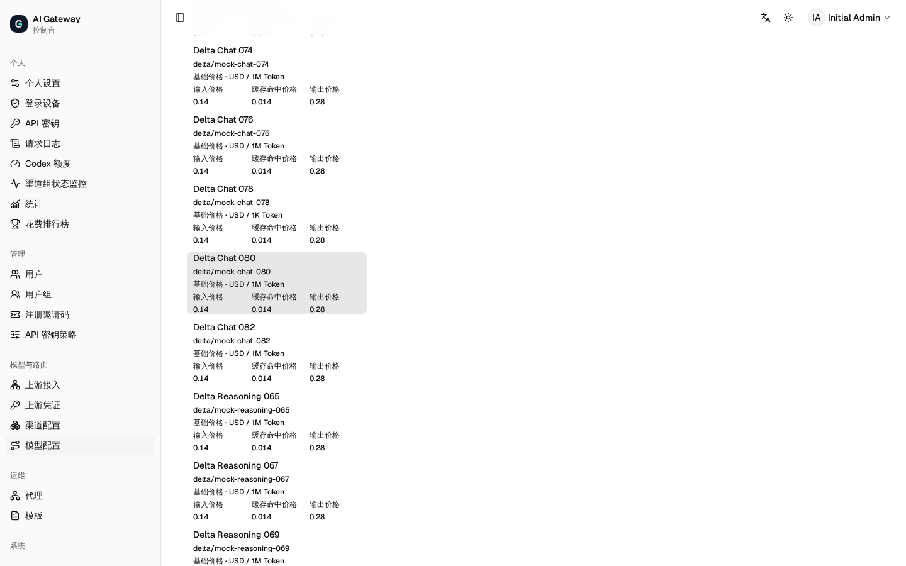
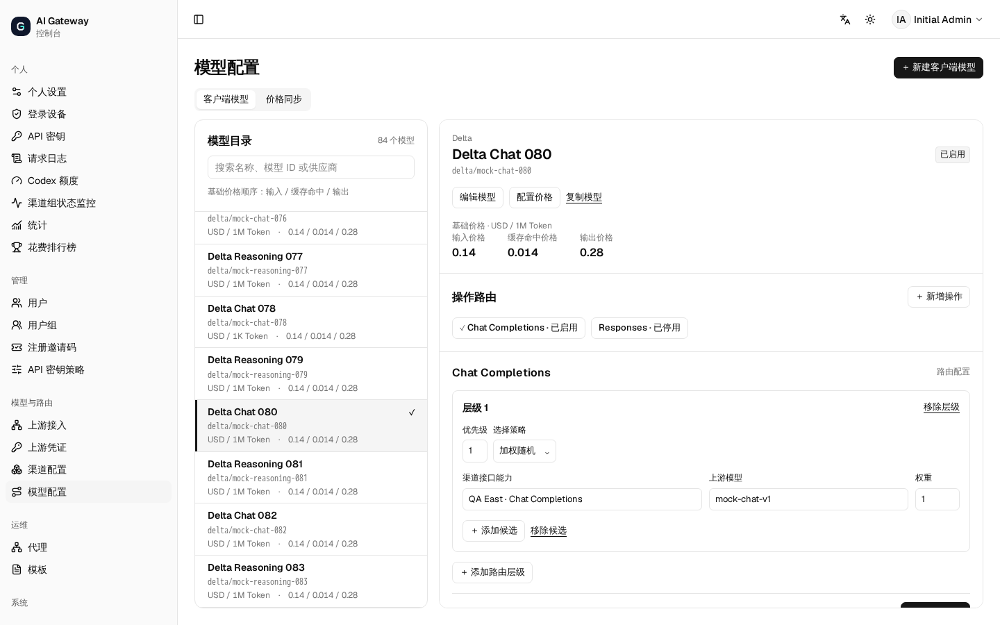

# Console 可用性审查与改版交接

> 状态：已完成设计记录。审查基线为 `9437c5f`。现状截图记录改版前的 Console；设计图是静态示意，不是实现截图。当前行为见[交互规范](console-interaction-standard.md)。

**首要改动：让“找到模型 → 看配置 → 换下一个”成为原地操作。** 不需要换主题：现在点击是生效的，但反馈落在几千像素之外。建议先独立交付模型工作区，再分别处理下文列出的其他流程；各项均不需要改 Console API。

审查使用真实 Chromium 151、中文浅色、网络层 mock。覆盖管理员的模型配置/定价、用户、系统设置、请求日志、移动导航，以及普通用户的请求日志和新建 Key 弹窗。它是按任务抽样，不是所有路由、主题或辅助技术的合规认证。

## 1. 模型页：把滚动归还给正在操作的区域

**复现。** `/admin/models` 返回 84 个模型（5 个供应商）。在 1440×900 打开列表，滚到 `Delta Chat 080`，点击一次。URL 和行选中态都变了，但页面高 **9,722 px**，`window.scrollY` 为 **7,971**；右侧详情区域从视口 **y = −7,771** 开始，整块不可见。以下是点击后的视口，不是加载失败：

[ModelsPage](../../web/console/src/features/admin/models/models-page.tsx) 在 `xl` 以上用一行 grid 并排两个自然高度的子项。左列绘制所有供应商和模型，每行重复一套价格表头；右列从 grid 顶部开始，选择操作只更新 `model` / `rule`。样本中普通行高 102 px，也没有按模型名或 ID 查找的入口。窄屏**已经是列表/详情切换**，不应再堆两栏；问题是返回后在列表顶端、焦点落到 `body`。390×844 从同一条目返回时，原行位于视口 y = 8,406。

### 宽屏：目录用于比较，详情用于编辑

图中操作规则和渠道为合成样例，用于展示有配置的状态。实现沿用 [Console 视觉规范](../../design.md)，不按图片像素重做现有表单。

| 区域 | 实现决定 |
|---|---|
| 可用高度 | 仅「客户端模型」在宽且足够高的视口使用剩余可视高度：Console 顶栏、页面标题和页签占自然高度，余下为 `minmax(0,1fr)` 工作区。建议从 `xl` 且高度 ≥ 44rem 启用；左栏约 20–21rem，右栏占余宽。滚动祖先要有可收缩高度（`min-h-0`）。不全局锁 `body`，价格同步和普通详情页保留自然滚动。 |
| 左：定位 | 目录头含「搜索名称、模型 ID 或供应商」和命中数；下方才是纵向滚动区。现有数据本地匹配，不区分英文大小写，保留供应商分组和稳定排序。每行先显示名称，再显示模型 ID，最后一行显示价格。把重复的三项价格标签提为固定图例；每行仍有实际 USD / Token 单位和三种精确值。屏幕阅读器能读出值对应的标签；长值换行，不取整，不假定所有模型按 1M 计价。选中态用背景＋标记，键盘焦点与选中态可区分。 |
| 右：确认对象 | 顶部是真正的模型标题、完整可复制的 ID、启用状态；紧接「编辑模型」「配置价格」和次要的「复制模型」。基础价格集中对齐显示。下面才是操作切换、添加和现有规则表单，保存只属于该表单。模型身份和启用状态不能与操作规则状态混淆。 |
| 选中与滚动 | 滚左列，页面和右列不动；滚长编辑器，左列不动。明确切换模型后，只将**右列**定位到新标题，原行保留在目录原位。连续用键盘浏览时保留目录焦点，并提供一个可聚焦的「进入当前模型配置」入口直达详情。不让用户 Tab 穿过余下几十条记录。再次选择当前模型不清空操作草稿。 |

不采用“点击后整页回顶”：它用丢失目录位置换取看到详情。只给右栏加 `sticky` 也不足以容纳多层路由的长编辑器。此阶段不需要虚拟滚动库、拖动分隔线或后端分页。

### 窄屏或短窗口：一次只做一件事

[390×844 详情设计图](console-ux-review/design-narrow.webp)。目录页用整页自然滚动；点击条目后切到同一路径的详情视图，呈现「返回客户端模型列表 → 模型名与 ID → 价格和操作」。焦点落到详情标题；候选编辑行放不下时，按「能力、上游模型、权重、移除」带标签纵排，不要求用户左右拖动才能填写同一条记录。

- **返回是回到原处。** 记住本次进入的行和滚动位置。局部返回和浏览器后退均恢复查询、可见行与焦点；若原行已不存在，回到搜索框并告知原因。不要在 URL 中保存像素坐标。由配置价格/编辑模型返回时保留既有 `returnTo`、模型和操作。
- **区分筛选与导航。** 搜索仅改变目录，不替换当前模型。结果不含当前模型时，右侧仍显示原对象；零结果显示「没有匹配的模型」和「清除搜索」，不显示「新建」代替清除。公开查询条件可用 `q` 替换当前历史条目，不为每个字符新增后退记录，也不因筛选丢弃草稿。
- **保留深链和草稿。** `model`、`rule`、`view=prices` 和旧入口继续可用。直达有效模型先显示它，不要求先点第一行；不存在的 ID 加载完成后给出返回目录的提示。已有脏规则时切模型、切操作、切页签或后退，沿用离开确认；取消保证 URL、选中态、滚动位置和字段值都没变。
- **空白要有含义。** 无模型给出新建入口；未选择显示简短选择提示；无规则时只显示一次「尚未配置操作」和新增动作。有数据的后台刷新失败保留当前内容和错误提示，首次加载与零记录不共用空态。

## 2. 其他能复现的问题与最小改法

优先级按对任务的影响排序。下表每一项可独立实现，最后一列是**改后**的验收条件，不是本次运行结果。源码路径相对 `web/console/src/`。

| 优先级 / 入口 | 已观察到的影响 | 建议设计 | mock 浏览器通过条件 |
|---|---|---|---|
| 高 · 邀请用户 `features/admin/users/users-page.tsx` | 844×390 横屏，弹窗高 642 px，顶部 y = −126、提交按钮 y = 468。滚轮也不能把它滚进视口。[现状截图](console-ux-review/short-dialog.webp) | 给这个长表单使用现有新建 Key 弹窗的限高＋内容滚动模式，保留标题、关闭与表单错误。无需更改所有 Dialog。 | 横屏鼠标滚动和键盘 Tab 都能从邮箱到提交再回到取消；焦点不被遮住。对照：同一视口新建 Key 弹窗内滚动后，提交位于 y = 326。 |
| 高 · 系统设置 `features/admin/system/system-page.tsx` | 上游连接超时从 10 改为 23，保存遇到模拟 409；refetch 后输入框直接变成另一会话的 24，自己的值消失。toast 不能让人找回改了什么。 | 借用 `features/api-keys/api-key-detail-page.tsx` 的冲突交互：保留 23 和旧基线，内联说明「版本已变更，草稿未保存」，阻止继续写。用户确认放弃后才载入最新完整设置；不自动合并或用新 ETag 重发旧表单。这是对现有自动重载体验的有意调整。 | 首次 PUT 带旧 `If-Match`；409 后仍见 23，取消加载不丢草稿，无第二次 PUT。确认加载见 24，重新编辑后的提交用新 ETag；加载失败可重试。保留现有冲突测试对**完整设置和 ETag**的验证。 |
| 高 · 用户批量修改 `features/admin/users/users-page.tsx` | mock 45 个用户，当前页 20 行，点「全选」立刻是「批量修改（45）」。弹窗虽有总数，但选择时没说明包含其他页，余额、状态修改的范围容易误判。 | 给页内选择明确标「选择本页 20 人」。若需跨页，另设显式「选择全部 45 人」。显示已选总数、清除入口；保留原有确认人数、100 人上限和邀请状态等限制。 | 选本页→翻页，第二页无勾选；跨页追加一人是 21。显式选全部才是 45；mock 提交的 ID 集合等于所选，而不是当前页或静默全量。 |
| 高 · 移动导航 `app/layouts/console-layout.tsx` | 390×844 打开侧栏点普通「用户」链接，URL、h1、表格均已切换，但抽屉仍遮着新页面，焦点停在抽屉链接。设置子项与普通项的关闭行为也不同。 | 移动端在导航成功后关抽屉，让焦点进入目标主内容；主动取消/Esc 才返回触发按钮。离开确认被取消时不要假装导航已成功。桌面折叠状态不变。 | 从模型页打开「用户」，只点一次就能操作用户列表；Esc 关闭不换页。普通项、设置子项、有草稿取消/确认各测一次。 |
| 中 · 个人 / 系统请求日志 `features/request-logs/request-logs-view.tsx` | 打开日志本应先看到最近一次请求。在 390×844，默认展开的筛选把第一条个人/系统记录推到 y = 1,101 / 1,172；系统表宽 1,242 px。**整页没有横向溢出**，问题是排查结果不在眼前。[系统页首屏](console-ux-review/mobile-logs.webp) | 窄屏收起详细筛选，标题下保留「筛选（已应用数）」与可清除的条件摘要；首屏先给时间、模型、结果和「详情」。用既有抽屉查看其余字段。桌面保留对齐的比较表；单元格长串不撑宽页面。 | 两种角色默认首条 mock 记录进入可视区。展开、编辑但未应用时不偷改结果；应用后摘要与请求参数一致，清除可回到全部。键盘可开关详情，回到触发行；个人页不出现系统筛选或他人字段。 |
| 中 · 模型定价 `features/admin/models/model-pricing-page.tsx` | 390×844、只有一个 UTC 窗口时，提交按钮已经在 y = 2,566。它属于计算器卡片底部，即使只改基础价格也得穿过排期、参考价格和计算器。 | 把「已保存/未保存、保存定价、放弃」作为**整个表单唯一**操作栏，不归计算器。移动端把计算器作为可展开的辅助工具；编辑时操作栏在底部可达，为末尾输入预留空间，极短视口不遮住焦点。桌面保留两列和现有计算能力。 | 仅改基础价格，无需打开计算器即可保存；丢弃或离开确认语义不变。只试算不提交，填入后才改变价格；含多个窗口与字段错误时可触达首个错误、最后字段及保存。 |

## 3. 给实现者的浏览器验收单

从 [Playwright 网络 mock](../../web/console/e2e/mock-api.ts) 和 [无后端代理的 Vite 配置](../../web/console/vite.e2e.config.ts) 起步。使用合成账号，拦截所有 `/console/v1/**`（未声明请求报错）；不启动 Rust、数据库或上游，不把演示数据接入生产代码。运行入口：`pnpm --dir web/console e2e`。在真实 Chromium 测几何、焦点和点击，而不只测组件能否渲染。

| 模型工作区用例 | 可执行的判据 |
|---|---|
| 目录压力 | 固定 84+ 条、多个供应商、同名不同 ID、长 ID、启用/停用、不同计价单位和高精度小数。1440×900 和 1280×720，从未筛选列表用滚轮到末组，再选一行。列表 `scrollTop` 已变、选中前后 `window.scrollY` 不变；选中行与正确的详情标题**同时落在未被顶栏遮住的视口**。滚长规则到末层不改变左列位置。不要只断言 `toBeVisible()`：元素可布局但远在屏幕外。 |
| 连续查找与编辑 | 名称、ID、供应商分别命中；验证无结果/清除。准备有规则、无规则和多层多候选模型；从深链开始，验证编辑/定价返回和脏草稿取消/放弃。列表与详情看到的单位和价格一致；仅切换/搜索不发写请求。 |
| 单栏与返回 | 390×844 用键盘打开末组条目，详情标题在首屏；用局部返回及浏览器后退分别回到原行、原筛选和焦点。320 CSS px 和 844×390 下检查换行、软键盘可用高度及所有动作可达；用专门的移动设备检查软键盘时同样只用 mock。 |
| 异常与视觉回归 | 覆盖慢响应、0 条、404/失效 ID、首次失败、已有数据刷新失败、保存冲突。中文/英文、亮/暗至少各走一次主流程。用 Tab/Shift+Tab 检查切换、搜索、进入详情、离开和确认，不能困在滚动区；不要用全局 `overflow-x:hidden` 掩盖问题。 |

回归用例位于 `web/console/e2e/ux-*.spec.ts`。运行 `pnpm --dir web/console e2e 'ux-.*\.spec\.ts' --trace on` 可查看真实浏览器截图、焦点操作和 mock 请求。视觉基线沿用 Nova/Geist、语义色和可见焦点；窄屏重排与固定栏检查分别参考 [W3C Reflow](https://www.w3.org/WAI/WCAG22/Understanding/reflow) 和 [Focus Not Obscured](https://www.w3.org/WAI/WCAG22/Understanding/focus-not-obscured-minimum)。静态设计图不是验收证据。
