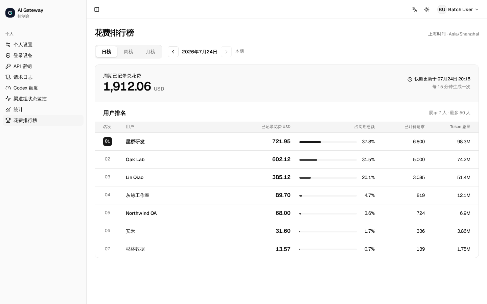

# 花费排行榜：周期费用排名单

> 状态：已完成设计记录。适用于 Console `/leaderboard`。现状截图记录改版前；方案图是静态排版，不是最终验收结果。

**用一份排名单代替领奖台。** 用户打开页面，应当能不滚屏就回答：“看的是哪一期？一共记录了多少 USD？谁花费最多，占多少？”保留前三名的辨识度，取消把相同的三个人分别画成头像卡、柱状图、表格的做法。高花费不是奖励、风险或异常，不用金牌色、警告色来评价人。

## 为什么改这一层，而不只是换配色

在 [现有页面](../../web/console/src/features/spend-leaderboard/spend-leaderboard-page.tsx) 上，以普通用户登录，注入 7 人的日榜快照。中文、Chromium 151、浅色、未滚动：

| 实测 | 桌面 1440×900 | 手机 390×844 |
|---|---:|---:|
| 完整排名表第一行顶部距视口顶部 | 1,307 px | 1,513 px |
| 排名表宽度 | 1,102 px | 638 px |

[现状桌面](spend-leaderboard-design/old-wide.webp) · [现状手机](spend-leaderboard-design/old-narrow.webp)。周期和历史导航各占一张卡；前三名按 **2、1、3** 排列，还要到图下方才能看总额，再往下才是可比较的请求数和 Token。手机不仅要纵向找表，还要在表内横向找数。只有一两名用户时，领奖台还会保留空位。问题是阅读顺序和重复编码，不是柱子的颜色。

## 设计稿与布局

[手机提案](spend-leaderboard-design/proposal-narrow.webp) · [深色提案](spend-leaderboard-design/proposal-dark.webp)。同一份样本的静态稿中，第一条排名分别在桌面 **y=392**、手机 **y=405**。这些坐标说明节省的空间，不是要求写死的高度。

| 从上到下 | 如何画、如何读 |
|---|---|
| 页标题与周期 | 一个 `h1`「花费排行榜」。标题旁注明「上海时间 · Asia/Shanghai」。只保留一组工具：**日榜 / 周榜 / 月榜**单选，其后紧邻「上一期 ‹　日期或区间　› 下一期」。当前显示「本期」；浏览历史时在同一位置提供「回到本期」。日期不是输入框，不暗示可以任意选日期。无需独立「历史」卡。 |
| 总额摘要 | 一个报告容器。顶部浅底横条，左侧「周期已记录总花费」及突出显示的 `1,912.06 USD`，右侧为实际快照刷新时间和「每 15 分钟生成一次」。时间采用上海时区，历史数据跨年时带年份。摘要随榜单一起换期，不把旧总额配给新榜。 |
| 桌面排名 | 摘要下直接显示「用户排名 · 展示 N 人，最多 50 人」。顺序为 **名次 → 用户 → 已记录花费（USD）→ 占周期总额 → 已计价请求 → Token 总量**。名称左对齐，金额右对齐、等宽数字；占比列在同一条 0–100% 标尺上画细横条，旁边写百分数。第 1 名用实底名次标记，其他以数字自然排序；每个人在榜单里只出现一次，不为前三名再预留三个位置。 |
| 窄屏排名 | 按**内容可用宽度**重排（设计稿约 45rem），而非把六列压成小字。每条记录三行：① 名次、用户、金额及 USD；② 占比条与带标签的百分数；③「已计价请求」和「Token」数。与桌面共用数据和分页；静态记录不是按钮，不设假行点击。长名优先换行，超长金额可单独占行；不靠悬停才能读完整名称或数值。 |

**视觉实现边界。** 复用 [Nova 和 Geist](../../design.md)：总额约 30–36px，行金额约 16px，名称 14px，次要数据不小于 12px。用细分隔线代替每行一张卡。占比统一用一个明暗主题可读的中性色；横条是辅助图形，百分比才是可读文本。桌面使用有表头的语义表格；手机使用同等可读的带标签列表或重排表格，辅助技术只读当前呈现的一份数据。比较设计参考 [GOV.UK 数字表格](https://design-system.service.gov.uk/components/table/)与[可视化的基线和可达性原则](https://brand.design-system.service.gov.uk/data/)。

## 交互和数据口径

- **换期：** 默认日榜。日/周/月改变时清除历史起点，回到该类型当前期；前后翻期使用响应的 `previous_period_start` / `next_period_start`，无相邻值相应箭头禁用，不用本地日期加减猜测。回到本期省略 `period_start`。自然周展示周一至周日，不能把排他的 `period_end` 当成最后一天。日期长时工具条换行；所有按钮有本地化名称，键盘可操作，切换后焦点保留在工具附近。
- **排序和分母：** 尊重返回的 `rank`，不因显示值舍入再排序；同名不同人用 `user_id` 作渲染 key，不显示 ID。摘要用 `total_cost_amount`，一行占比为 `cost_amount / total_cost_amount`，分母不是前三名、当页或前 50 人之和。展示条数不等于参与总人数；不编造总人数、「我的全站排名」、环比或实时趋势。
- **数值：** 金额保留 USD 与现有有效精度；非零极小值不能误报为零（低于显示精度时给出明确上界或原值）。占比常规保留至一位小数，正值不足 0.1% 可标 `<0.1%`。已计价请求用 `priced_request_count`，不是 `request_count`；Token 是该用户周期内全部请求的 Token。周期总额为 0 且有已定价记录时仍展示榜单，金额为零、占比为「—」、不画条。
- **分页：** 保留前 50 名和现有本地分页（默认 20，每页 10/20/50）。翻页不改变分母、摘要和全榜名次；换到其他周期从第 1 页开始。不加搜索、二次排序或新接口。
- **状态：** 首次加载显示稳定的摘要/行骨架，不短暂显示 `0 USD`。`refreshed_at=null` 且无条目写「尚无快照」；有刷新时间但无条目写「该周期没有已计价请求」，不写「没有请求」。一人或两人直接显示相应行。请求失败就地提示并可重试；同一周期后台刷新失败可保留上次成功的报告和时间，但不要将旧周期数据标为新周期。日/周/月和返回本期仍可用于离开错误状态。

**开发落点。** 限定在 `web/console/src/features/spend-leaderboard/`、相关翻译、测试和文档。沿用[查询 hook](../../web/console/src/features/spend-leaderboard/api.ts)和[现有统计口径](statistics.md#花费排行榜)；不改 worker、授权、快照频率或 API。可复用 `ToggleGroup`、表格与 `TablePagination`；不为这个页面重写共享表格。实现时同步[用户说明中的领奖台描述](../user/observability.md#查看花费排行榜)和统计指南；把[组件测试](../../web/console/src/features/spend-leaderboard/spend-leaderboard-page.test.tsx)及现有浏览器 smoke 中**针对领奖台/人员重复出现**的断言替换为对顺序、金额、操作和首屏的断言，保留普通用户访问、自然周期、历史导航与总额覆盖。

## 实现后的验收：mock 数据 × 真实 Chromium

复用 [`mockConsoleApi`](../../web/console/e2e/mock-api.ts) 和现有 [Playwright 配置](../../web/console/playwright.config.ts)。拦截 `/console/v1/statistics/spend-leaderboard`，按查询返回**不同**快照；不能让日、周、月始终返回同一 fixture。不启动网关、不连接数据库或上游。以下是验收条件，而非已经通过的交互测试：

| 场景 | 通过条件 |
|---|---|
| 首屏与阅读顺序 | 同一组 7 人（日榜总额 `1,912.06`，第一名 `721.95`，占比 `37.8%`）。普通用户进入后，桌面 1440×900、手机 390×844 都不滚动即可完整看到周期、总额及前 3 名的名称和金额。以元素与视口的交集断言，不只用 `toBeVisible()`。按 1→7 出现一次。 |
| 跨周期与翻页 | 在日、周、月之间切换，核对请求的 `period`、`limit=50` 和 `period_start` 的有无。模拟非连续历史日期、跨月周及无下一期，验证箭头请求服务端给定的日期、日期标签不多一天、「回到本期」复位。模拟浏览器时区与上海不同、快速连切/乱序返回，行与总额、时间始终属于同一快照。 |
| 分母、排序与边界 | 模拟 51 位参与者，仅返回 50 位；全体总额 1,000，第一名 200，前 50 名合计 990。第一名必须显示 **20%**，不显示 20.2%；第 2 页从第 21 名开始，摘要仍为 1,000。再测同额同名、零费用但已定价、低于显示精度的费用和不同的请求/已计价请求数。 |
| 状态与可访问性 | 0、1、2 人无虚设奖台；区分首次加载、尚无快照、已有空快照、失败与重试。320px、中文长名、英文跨月日期、亮/暗下不出现整页横向滚动，不截断金额或藏列。仅用键盘切周期、翻历史与翻页；读屏能读出名次、姓名、金额/单位、占比，且不需探索图形。 |

交付时运行覆盖上述场景的 `pnpm --dir web/console e2e` 用例，附**实际产品页面**同一 mock 下的桌面和手机截图、至少一个历史切换的 trace。静态设计稿只校验过排版，不能替代这一步。
